<!-- Rotates weekly: see .github/workflows/rotate-profile.yml and assets/portraits/ -->

  

  
  
  
  

<h2 align="center">
  <a href="https://raw.githubusercontent.com/ru44/How-to-break-the-law/main/HelloWorld.js">Hello World</a>, I'm RuM
  
</h2>

<!-- Rotates weekly; edit the text in scripts/build-status.py -->

  

## `cat ~/.stats`

  

  
  

  

## `which -a tools`

<b>Languages, frameworks, databases, DevOps, editors</b> (click to expand)

 

**Languages**

**Frameworks and libraries**

**Databases**

**DevOps and tools**

**Editors**

## `sudo make coffee`

  
  

## `ls ~/projects`

| Project | What it is | Stack |
| --- | --- | --- |
| [blackarch-website](https://github.com/ru44/blackarch-website) | The new website for BlackArch Linux: 15 languages, tools browser, architecture explorer | VitePress, Vue |
| [CLIuno/core](https://github.com/CLIuno/core) | A CLI to make your journey in web development less painful | TypeScript |
| [CloudyClipy](https://github.com/ru44/CloudyClipy) | Your own clipboard in the cloud | TypeScript |
| [wifi-scanner](https://github.com/ru44/wifi-scanner) | Lists nearby Wi-Fi networks on Linux, for when you have the password but not the name | Rust |
| [note9-nethunter-kernel](https://github.com/ru44/note9-nethunter-kernel) | NetHunter kernel for the Galaxy Note 9 | Shell |
| [msr90](https://github.com/ru44/msr90) | Card reader for the MSR90 | Shell |
| [Matrix-Synapse-with-Keycloak-SSO](https://github.com/ru44/Matrix-Synapse-with-Keycloak-SSO) | Matrix Synapse with Keycloak single sign-on | Docker |
| [eWPT](https://github.com/ru44/eWPT) | eWPT exam notes | Notes |

<code>[ connection closed by foreign host ]</code>

